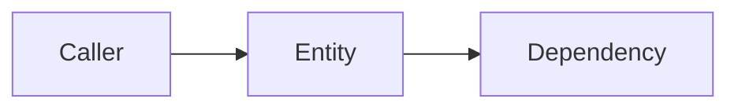

# Entity name

## What it is

One paragraph: what this component, service, data store, external system,
person or team is, and where it lives ([code](../../bootstrap.sh)).

## Responsibilities

- What it owns and is accountable for.

## Interfaces and dependencies

What it talks to, and what talks to it.

## Quirks

Gotchas, limits and known issues, each with evidence.

## Related

- [Other page](../index.md)
